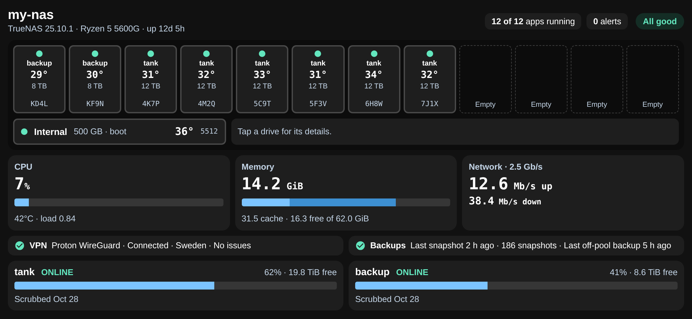

# NAS Bays for TrueNAS

A simple Home Assistant card for your TrueNAS server: your drives across the top, then CPU, memory, network and your pools, on one screen. It only reads from the NAS. Nothing on the card can change anything.



> **Beta (0.3.3).** It runs every day on my own server with TrueNAS 27 RC.1 and Home Assistant 2026.10. It needs TrueNAS 25.10 or newer, but I haven't tried those earlier versions. If you do, please [open an issue](https://github.com/spikey1965/ha-nas-bays/issues) with what works and what doesn't.

## What it shows

- **Drives:** up to 12 bays across the top with health, temperature, size and the end of the serial. Tap one for its details.
- **CPU, memory and network:** the current figures and simple bars.
- **Pools:** status, how full, free space and the last scrub. It warns when a pool fills up or a scrub is overdue.
- **Backups:** the last snapshot, and whether replication, cloud or rsync tasks are set up and working.
- **VPN (optional):** one line saying whether your VPN is connected.

## Install

### 1. Make a read-only account on TrueNAS

1. **Credentials → Users → Add.** Give it a name such as `ha-monitor`, and the **Readonly Admin** role.
2. Add an **API key** for that user and copy it. TrueNAS only shows it once.

Please don't use your admin account. With a read-only account, nothing in Home Assistant can change your NAS.

### 2. Install the integration

**HACS (recommended):**

[](https://my.home-assistant.io/redirect/hacs_repository/?owner=spikey1965&repository=ha-nas-bays&category=integration)

Or in HACS, open the three-dot menu → **Custom repositories**, paste this repository's address and choose the type **Integration**. Then download **NAS Bays for TrueNAS** and restart Home Assistant.

**Manual:** copy `custom_components/nas_bays` to your `config/custom_components` folder and restart Home Assistant.

### 3. Connect it

**Settings → Devices & services → Add integration → NAS Bays for TrueNAS.** Enter the NAS's address, its HTTPS port and the API key.

- It only connects over HTTPS, because TrueNAS revokes API keys that are sent over plain HTTP.
- If you use TrueNAS's default self-signed certificate, untick the certificate check.

### 4. Add the card

**Edit dashboard → Add card → NAS Bays**, or use this YAML. The integration provides the card, so there's nothing else to install.

```yaml
type: custom:nas-bays-card
```

## Settings

Everything in the card's visual editor can also be set in YAML.

| Option | Default | What it does |
| --- | --- | --- |
| `mode` | `full` | `compact` gives a small summary card |
| `theme` | `auto` | `light` for dark text, `dark` for white text |
| `name` | NAS's hostname | The title on the card |
| `bays` | `12` | How many bays to show |
| `slots` | automatic | Drive serials in bay order, using `null` for an empty bay |
| `hide` | none | Any of `cpu`, `memory`, `network`, `vpn`, `backups`, `storage` |
| `max_width` | `1100` | Widest the card gets, in pixels. `0` fills the space |
| `fill` | `false` | Stretch the card to the bottom of the screen, for wall tablets. Not on phones |
| `fill_bottom` | `16` | Gap in pixels to leave below the card when `fill` is on |
| `pool_names` | none | Shorter names for the drive bays, such as `{ my-long-pool: data }` |
| `temp_warn` | `50` | Drive temperature, in °C, shown in amber |
| `scrub_warn_days` | `45` | Days since the last scrub before it's marked overdue |
| `snapshot_warn_hours` | `48` | Hours since the last snapshot before Backups warns |
| `warn_no_replication` | `false` | Warn when there's no replication, cloud or rsync task |
| `vpn_entity` | none | A sensor for the VPN line (see below) |
| `vpn_label` | none | The text on the VPN line, such as `Surfshark OpenVPN` |
| `background` | theme | A card background colour |

TrueNAS can't tell which physical bay a drive is in, so drives fill the bays in order. To match your case, pick the drive for each bay in the card's editor, using the serial on its label. **Always check the serial on the drive before you pull it.**

## Optional: VPN line

The line can read any Home Assistant sensor. It counts as connected when the sensor's state is `connected` or `on`.

If you use [Gluetun](https://github.com/qdm12/gluetun), the [helper script](extras/nas_bays_vpn_status.py) sends its status to Home Assistant, and the provider, VPN type and country come from your Gluetun settings. Run it every minute from cron on the machine that runs Gluetun:

```sh
python3 nas_bays_vpn_status.py --ha-url http://HOME-ASSISTANT:8123 --token-file /path/to/token
```

Then set `vpn_entity: sensor.nas_vpn` on the card. The token file holds a Home Assistant long-lived access token. If the script stops running, the card shows "No data" after 5 minutes.

"Connected" means Gluetun's own health check is passing. It isn't a separate test from outside your network.

## Want one designed for your server?

This card stays simple on purpose. If you'd like it to match your actual case, with extra detail such as gauges, charts and per-core CPU, I can [design one for your own server](https://mymediabuild.uk/custom-home-assistant-cards/).

## Good to know

- Figures update every 30 seconds, so it isn't live to the second.
- Network speeds add up all ports that have a link.
- TrueNAS is a trademark of its owner. This project isn't connected to or endorsed by iXsystems.

Guide: [mymediabuild.uk](https://mymediabuild.uk/home-assistant-truenas-card/) · [Report a problem](https://github.com/spikey1965/ha-nas-bays/issues) · [Buy me a coffee](https://buymeacoffee.com/bobgreggr)
